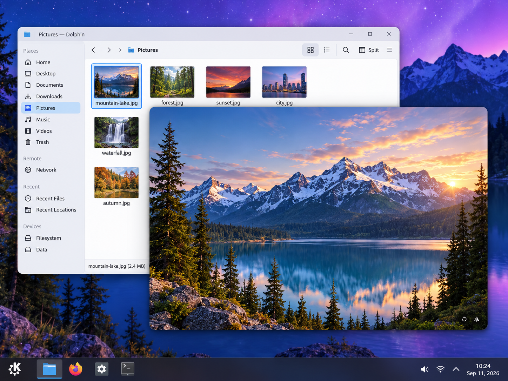
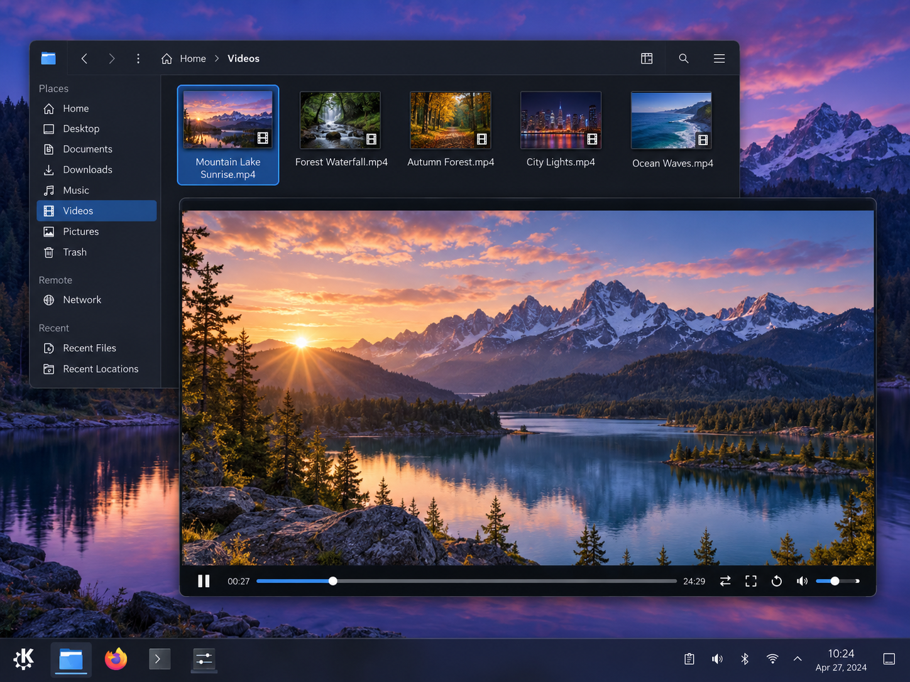
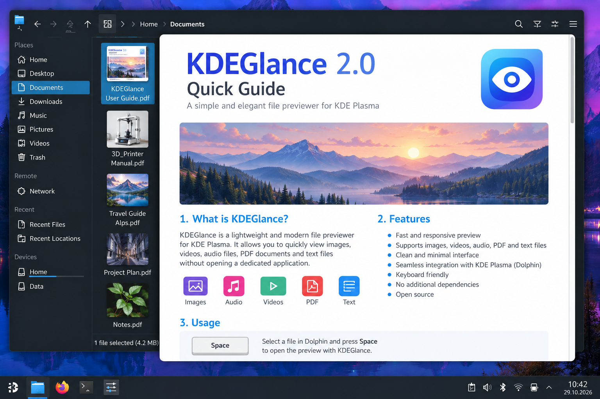
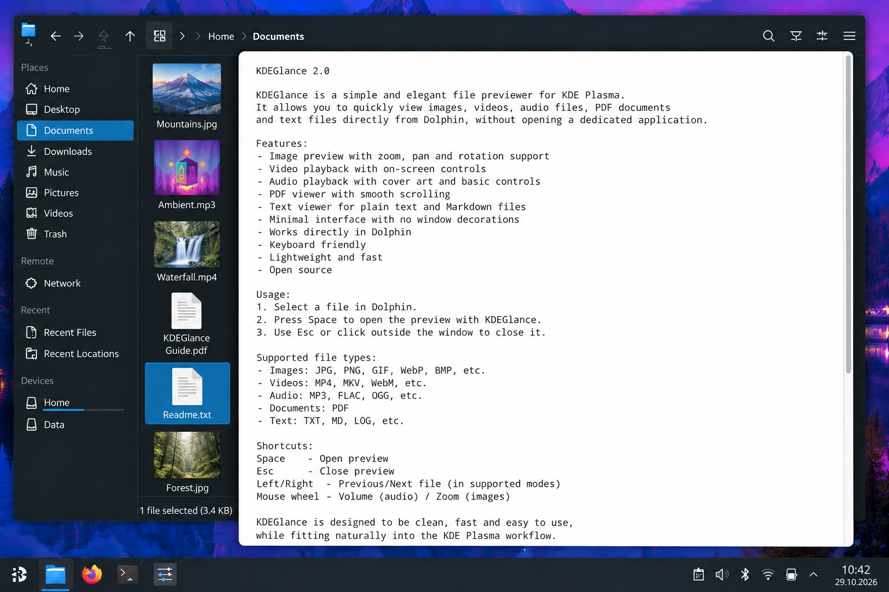
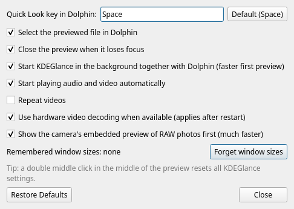

# KDEGlance 2.0.1

Quick Look-style file previews for **Dolphin on KDE Plasma 6**. Select a file and
press **Space** to inspect it in a minimal, frameless window. Browse the folder
with the arrow keys, or press **Enter** to open the original file in its default
application.

KDEGlance 2.0.0 is the C++20 / Qt 6 / KDE Frameworks 6 release of the project.
The supported and tested desktop is **CachyOS, Plasma 6, Wayland and KWin**.
Arch Linux with equivalent dependencies is the packaging target. No binaries for
other distributions or architectures are supplied by this release.

[Downloads and releases](https://github.com/AlexGraveler/KDEGlance/releases) ·
[Release notes](RELEASE-NOTES.md) · [Installation](docs/INSTALL.md) ·
[Validation](docs/RELEASE-VALIDATION.md)

Version 2.0.1 changes only PDF vertical mouse-wheel scrolling to 3× speed;
Ctrl+wheel zoom, horizontal scrolling and other viewers retain their behavior.

## Features

- Dolphin integration through a Space-key hook and a **KDEGlance: Quick Look**
  context-menu action. File navigation follows Dolphin's order and can synchronize
  its selection with the preview, including separate source-window sessions.
- Space/Escape closes the preview; Enter and keypad Enter open the original URL
  with KDE's MIME association through KIO. Audio/video stops before launching.
- Images, camera RAW, animations, video, audio, text, Markdown, PDF and Writer
  documents share a minimal frameless presentation.
- Remembered window sizes are independent for images, video, audio, PDF, text and
  office documents. Double-click the middle button to reset only the active module.
- A resident, D-Bus-activated viewer is reused between previews. Closing a preview
  releases its playback source without terminating the background service.
- Focus-loss closing, selection synchronization, background prestart, autoplay,
  hardware decoding and image/RAW preferences are configurable.
- Files are viewed, not edited. Rotation, reflection, zoom, decoding and document
  conversion do not modify the original.

## Screenshots

Screenshots of KDEGlance 2.0 running on KDE Plasma.

| Image preview | Audio with cover |
|---|---|
|  |  |

| Audio without cover | Video preview |
|---|---|
|  |  |

| PDF preview | Text preview |
|---|---|
|  |  |

| Settings |
|---|
|  |

## Supported file types

The installed image plugins, LibRaw and FFmpeg determine which individual variants
can be decoded. An extension is not a guarantee for every codec, camera or file.
See [the format and dependency matrix](docs/FORMATS.md).

| Module | Formats |
|---|---|
| Images | JPEG/JPG/JFIF, PNG/APNG, GIF, BMP/DIB, TIFF, WebP, ICO/CUR, ICNS, TGA, PNM/PBM/PGM/PPM, PCX, PSD/PSB composite, SVG/SVGZ, HDR; AVIF, HEIF/HEIC, JPEG XL, JPEG 2000 and OpenEXR with their installed plugins |
| Camera RAW | CR2/CR3/CRW, NEF/NRW, ARW/SRF/SR2, RAF, ORF, RW2/RWL, PEF, DNG, SRW and other LibRaw camera formats; support depends on the camera and LibRaw version |
| Video containers | MP4/M4V, MKV, WebM, MOV/QT, AVI/DivX, WMV/ASF, MPEG/MPG/MPE, TS/MTS/M2TS, VOB, FLV/F4V, 3GP/3G2, OGV; MXF, DV and RealMedia when supported by FFmpeg |
| Video codecs tested with fixtures | H.264, HEVC, AV1, VP8, VP9, MPEG-4/Xvid, MPEG-2, MJPEG, ProRes and DNxHD |
| Audio | MP3/MP2, FLAC, WAV, AIFF, AAC/M4A/M4B/ALAC, Ogg Vorbis, Opus, WMA, APE, WavPack, Musepack, TAK, TTA, Shorten, AC-3/E-AC-3, DTS, AU/SND; AMR, RealAudio and trackers depend on the backend |
| MIDI | MID/MIDI/KAR/RMI is experimental and requires FluidSynth plus a SoundFont |
| Text | TXT, LOG, MD/Markdown, CSV, INI, JSON, XML, YAML/YML, CONF, TOML and plain-text source files |
| PDF | PDF, including continuous page viewing and optional text reflow |
| Office documents | DOC, DOCX, DOCM, RTF, ODT, OTT and FODT through LibreOffice Writer-to-PDF conversion |

Apple Pages and some less common image/tracker formats are experimental; they are
not advertised as guaranteed document support. Spreadsheets, presentations,
archives, editing and media-library management are outside this release.

## Images and window geometry

Without a remembered manual size, an image opens at 100% (one source pixel per
device pixel), reduced only as needed to fit the work area. A remembered manual
size is restored and the image fits inside it without distortion; mismatched
proportions produce black bars.

The mouse wheel changes the photo's temporary scale and lets the window follow
its size up to the work-area limit. Beyond that limit the image continues zooming
inside the fixed viewport. When zooming out of a crop, the image first shrinks
inside the existing window; once it fits, the window shrinks with it. Zoom is
calculated around the cursor in viewport coordinates and constrained by the
available pan range. An image that exactly fills its window has no free pan range.

**Final mouse behavior:** drag a zoomed image **without Alt** to pan the image;
**Alt + drag** moves the window while preserving the image's local scale and offset.
An ordinary drag also moves the window when the image has no overflow to pan.
Dragging a border/corner without Alt freely changes the window's shape. Alt held
at the start of a border/corner resize preserves the photo's aspect ratio.

Only manual window resizing is remembered. Wheel zoom, its temporary window size,
pan, automatic fit and KWin tiling/maximization do not overwrite that manual size.
KWin owns the window's position and managed geometry after its initial placement.

EXIF orientation, view-only counterclockwise rotation, horizontal reflection,
multi-page TIFF and animated GIF/WebP are supported. Decoding is asynchronous;
a sharper source is requested when zooming requires it. RAW can use an embedded
preview before full decoding.

## Video and audio

Video has play/pause, a seek bar, duration, volume/mute, fullscreen, one
counterclockwise rotation button and a **Repeat** toggle. The two-arrow button is
repeat playback: when enabled, reaching the end seeks back to the start and plays
again. It is not a second rotation button. Four rotation presses return to the
original orientation. The wheel zooms video, and dragging a zoomed frame pans it.
Side clicks navigate through the same mixed-file list used by other modules.

Audio displays title, artist and an embedded or adjacent album cover when
available, with a placeholder otherwise. Play/pause, seeking, volume/mute and file
navigation are available in the compact player. Closing or switching previews
stops the previous audio/video source. Audio and video have separate remembered
window sizes and volume/mute preferences; Repeat is a video setting.

Hardware video decoding is used when usable; a software fallback handles systems
where hardware initialization or frame delivery fails. Actual codec support
remains dependent on Qt Multimedia/FFmpeg.

## Text, PDF and office documents

Text is read-only, without a permanent toolbar or encoding menu. Encoding is
chosen automatically using BOM/Unicode checks and legacy-encoding heuristics,
including Windows-1251, KOI8-R, CP866 and Windows-1252. Ambiguous short legacy text
can still be misidentified. Markdown can switch between source and rendered view.
Wheel scrolling has the existing doubled speed, including pixel-delta input.
Large text is loaded in chunks; scrolling near the end or Ctrl+PageDown requests more.

PDF uses Poppler for continuous page viewing, scrolling, zoom, fit-to-width and
text reflow. Page images are rendered on demand with a bounded cache. Reflow
uses the document's text layer, so scanned pages do not gain OCR.

Office documents are converted asynchronously to a temporary PDF with a separate
headless LibreOffice profile, then use the same PDF viewer. DOCM conversion does
not intentionally run macros; the temporary profile disables macro execution
and link updates. Documents are not modified or saved back. Import fidelity is
limited by LibreOffice; password-protected or damaged documents may fail.

## Keyboard and mouse controls

| Input | Action |
|---|---|
| Space in Dolphin's file view | Open/toggle preview; text-entry fields keep normal Space behavior |
| Space / Escape in preview | Close; Escape first leaves fullscreen video |
| Enter / keypad Enter | Close preview and open the original file/URL in its default application |
| Left / Right | Previous / next file; synchronize the source Dolphin selection when enabled |
| Leftmost / rightmost 20% of image, cover or video content | Previous / next file, outside playback controls |
| Center content click | Close preview |
| Single middle click / double middle click | Close / reset only the active module |
| Wheel on photo | Temporary image zoom and adaptive window size |
| Drag overflowing photo without Alt | Pan the photo inside the window |
| Alt + drag photo | Move the window, preserving local image state |
| Drag fitted photo | Move the window when there is nothing to pan |
| Drag edge/corner without Alt | Free window proportions; photo fits without distortion |
| Alt + drag edge/corner | Photo-proportional manual resize; other modules retain their existing ratio rule |
| Image + / −, F or 0, 1 | Zoom, fit, 100% respectively |
| Image double click | Toggle fit / 100% |
| Image R; rotation / reflection icons | Counterclockwise rotation; view-only transforms |
| PageUp / PageDown on multi-page image | Previous / next image page |
| Video play/pause button | Start or pause; Space remains preview close |
| Seek bar click/drag; wheel over seek bar | Seek; one second per wheel step |
| Speaker click; wheel over volume control | Mute; adjust volume |
| Video Repeat button | Toggle repeat playback |
| Video F / double click / fullscreen button | Toggle fullscreen |
| Video R / rotation button; 0 | Rotate counterclockwise; reset video zoom |
| Wheel over video; drag zoomed video | Zoom; pan; Alt-drag moves the window |
| Wheel over text/PDF; document navigation keys | Scroll |
| Drag text/PDF; Shift + drag | Move window; select text respectively |
| Markdown M | Toggle rendered Markdown / source |
| PDF/Office Ctrl+wheel or + / −; F or 0; R | Zoom; fit width; toggle text reflow |
| Text Ctrl+PageDown | Load the next text chunk |
| Focus outside preview | Close if focus-loss closing is enabled |

System-wide KWin bindings can intercept modified mouse gestures before the viewer
receives them. KDEGlance does not change global shortcuts or mouse bindings.

## Installation on Arch Linux / CachyOS

Build the Arch package from the current packaging recipe. The same workflow
applies to EndeavourOS. Run `makepkg` as a regular user:

```bash
sudo pacman -S --needed base-devel git
git clone https://github.com/AlexGraveler/KDEGlance.git
cd KDEGlance/packaging/arch
makepkg -si
```

The recipe builds **KDEGlance 2.0.1-1** from the official
[v2.0.1 source archive](https://github.com/AlexGraveler/KDEGlance/releases/download/v2.0.1/kdeglance-2.0.1.tar.gz)
and verifies its SHA-256. It does not compile the changing `main` source tree.
Use the current packaging files; checking out `v2.0.0` selects the older packaging
included in that tag. `makepkg -si` resolves dependencies, builds the application,
runs the tests and asks Pacman to install the package.

**LibreOffice is optional for using KDEGlance.** It enables Office document
previews (DOC, DOCX, ODT and other supported formats). Without it, Office files
show a dependency message; images, PDF, text, audio and video remain available.
The complete test suite generates and converts Office documents, so LibreOffice
is listed in `checkdepends` and is required when building with those tests.
It is not a mandatory runtime dependency of the resulting package.

Close and reopen Dolphin after installation or upgrading to load both plugins.
The viewer starts on demand through D-Bus/systemd; no global Space binding or
custom Dolphin launcher is required. User preferences are preserved.

See [the Arch packaging instructions](packaging/arch/README.md) and
[PKGBUILD](packaging/arch/PKGBUILD) for dependencies, checks and future version
updates. The existing GitHub Release and its `2.0.0-1` binary asset are unchanged;
this packaging revision does not replace that download.

### Binary compatibility

The recipe respects makepkg compiler flags. CachyOS builds can inherit native
CPU flags or x86-64-v3 startup objects; use a standard Arch chroot when producing
binaries for baseline x86_64 hardware. The binary package records the build-time
Qt version as a minimum runtime dependency because newer Qt plugins cannot load
on an older Qt minor.

For an older manually installed Python 1.x version, first read
[the migration notes](docs/INSTALL.md#updating-and-migration). The package does not
remove user-local launchers or overwrite unrelated KDE configuration.

## Settings and removal

Open **KDEGlance Settings** from the application launcher or run
`kdeglance --settings`. Preferences are stored in
`~/.config/kdeglance/settings.json`, with atomic saving and recovery backup.

```bash
sudo pacman -Rns kdeglance
```

Reopen Dolphin afterward. Package removal stops the viewer and removes its program
files; it preserves your settings. No global KDE settings are changed.

## Known limitations

- Only the supplied x86_64 package has been built and tested. No independent
  clean-machine Arch, other-distribution or multi-monitor/mixed-DPI certification.
- Dolphin integration uses private Dolphin symbols. Future Dolphin releases may
  require rebuilding or adapting the plugin; failures are diagnosed instead of
  assuming file-order/selection access succeeded.
- Native input smoothness, physical electric-edge drags and all KWin shortcut
  configurations need manual acceptance. KWin owns tiling/maximization; it is not
  disabled. Wayland placement on other compositors is not promised.
- Codec/camera/import availability depends on the system libraries. Encrypted,
  damaged or unsupported variants may fail with an error card.
- KIO Fuse is preferred for remote previews; a cancellable KIO copy is the
  fallback. Network availability, authentication and protocol support are system
  dependent. Enter passes the original URL to KIO. No physical iPhone/AFC test is
  claimed; a test HTTP server does not prove SMB access to every server.
- Automatic legacy-text detection is heuristic. PDF reflow is not OCR, and office
  conversion is not guaranteed to preserve every layout detail.
- The explicit whole-application reset in Settings/CLI differs from double-middle
  reset: only the latter is scoped to the active module. Global autoplay/hardware
  policies remain global.

## Development and license

See [architecture](docs/ARCHITECTURE.md), [testing](docs/TESTING.md),
[manual acceptance](docs/MANUAL-ACCEPTANCE.md) and [CONTRIBUTING.md](CONTRIBUTING.md).
License: **GPL-3.0-or-later**; see [COPYING](COPYING) and [LICENSE](LICENSE). Qt/KDE/FFmpeg/LibreOffice are system dependencies,
not bundled with the release package. KDEGlance is an independent project, not an
official KDE application.
