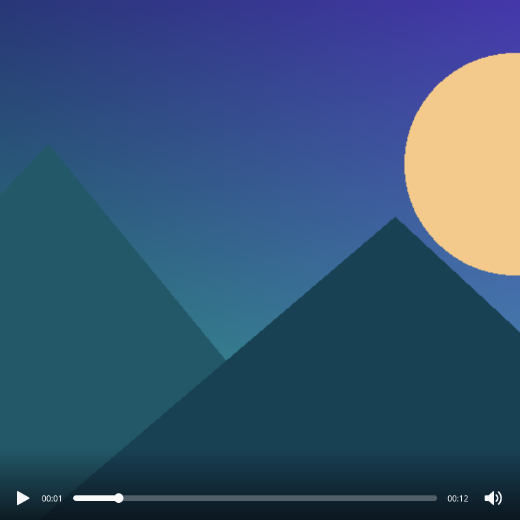
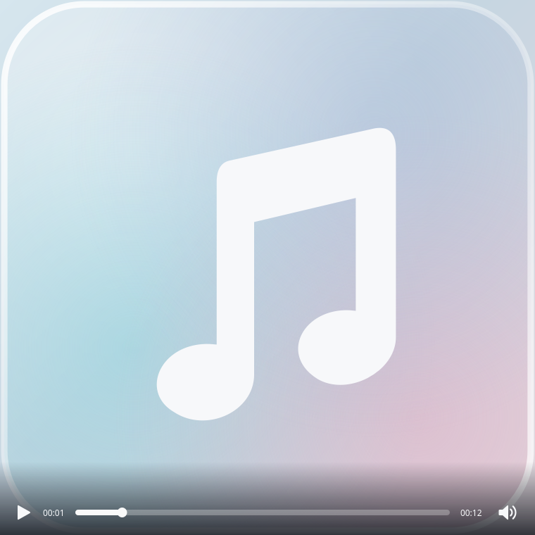
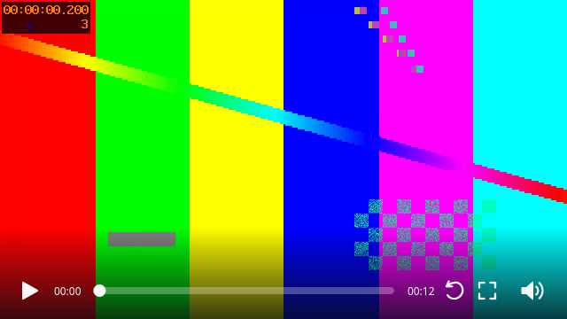

# KDEGlance

**Quick Look-style file preview for KDE Plasma and Dolphin**

KDEGlance **1.0.0** opens a borderless preview of the selected file in Dolphin.
Preview an image, listen to audio, or watch a video without opening a full editor
or media-library application. Move through a mixed folder while keeping
Dolphin's selected and current keyboard item in sync.

## Features

- Images: JPEG/JPG, PNG, WebP, BMP, GIF, HEIC/HEIF and Canon CR2, subject to
  installed Qt image plugins. Automatic EXIF orientation and bounded decoding.
- Animated GIFs, including long/large animations decoded ahead through a small
  worker-thread buffer instead of loading every frame into memory.
- Pointer-centered image zoom, panning, counterclockwise rotation and horizontal
  reflection. Transformations affect the preview; files are not edited.
- Audio: MP3, FLAC, OGG, WAV, M4A and AAC; embedded covers or a glass-style
  placeholder, play/pause, seeking, and volume control.
- Video: MP4, MKV, WebM, AVI, MOV, M4V, MPEG/MPG, TS/MTS/M2TS, OGV, 3GP,
  WMV, FLV and RMVB. Actual decoding depends on the system's Qt Multimedia/FFmpeg
  backend and codecs. Natural-aspect previews, rotation, fullscreen and zoom.
- Frameless movable windows, focus-loss closing, and controls that fade on
  inactivity or when the pointer leaves the preview.
- Explicit mixed-file navigation and Dolphin selection synchronization. Merely
  changing Dolphin's selection does not start another preview.
- Local paths, file URLs, mounted drives and SMB URLs through KDE KIO Fuse.
  General AFC/iPhone, SFTP and other KIO URL handling is **not included** in 1.0.0.

## Screenshots

These are captures of the real Qt widgets and media player, using the original
synthetic media kept in the repository with the tests. They were captured offscreen, not drawn
as interface mockups; native compositor effects/placement are not demonstrated.

| Image preview | Image controls and zoom |
| --- | --- |
|  |  |

| Embedded audio cover | No embedded cover |
| --- | --- |
|  |  |



## Installation

For the smallest download, use `KDEGlance-1.0.0.tar.gz` from the project's
GitHub Releases once published. It contains the full required application source,
installer and license notices, without developer tests, screenshots or example
media. Extract it and run `bash install.sh` in the extracted folder.
The repository keeps the full documentation, Markdown screenshots and developer
tests; they are not installed or included in the user archive.

On CachyOS or Arch Linux, in a normal KDE Plasma Wayland user session:

```bash
git clone https://github.com/AlexGraveler/KDEGlance.git
cd KDEGlance
bash install.sh
```

The installer checks dependencies, offers the exact `pacman` command if packages
are missing, builds the small activation bridge locally, and asks before changing
user integration. Do **not** run the whole installer as root.

A read-only check is available with `bash install.sh --check`.
See [INSTALL.md](INSTALL.md) for requirements, manual Space binding, updates and removal.

## Usage

Reopen Dolphin after installation. Open **Settings → Configure Keyboard Shortcuts**,
search for **KDEGlance: Quick Look** (or its translated name), and assign **Space**.
Review any shortcut conflict in Dolphin's dialog rather than overwriting it blindly.
The installer deliberately does not edit shortcut configuration files.

Select a supported file and press Space. Use the preview controls or arrow keys.
Close with Space, Escape, a center click, or by moving focus to another application.
Dolphin's selection remains on the last successfully previewed image/accepted media
item when synchronization with the original folder is available.

CLI examples (ensure `~/.local/bin` is on PATH):

```bash
kdeglance --version
kdeglance open -- /path/to/file.jpg
kdeglance toggle -- /path/to/file.mp3
kdeglance close
kdeglance state
```

## Keyboard and Mouse Controls

| Input | Action |
| --- | --- |
| Space | Open from Dolphin after manual binding; close an active preview |
| Escape | Close; in fullscreen video, leave fullscreen first |
| Left / Right | Previous / next supported item, including mixed media |
| Center image/cover click | Close preview |
| Left / right area click | Previous / next item (outside the controls) |
| Mouse wheel on image/video | Zoom around the pointer |
| Drag zoomed image/video | Pan content; fitted content/window dragging follows existing viewer rules |
| Drag window; Alt-drag | Move preview using the compositor |
| 0 or F | Fit an image to the window; F toggles video fullscreen |
| Video double click | Toggle fullscreen |
| Play/pause button | Toggle audio/video playback |
| Click/drag progress bar | Seek audio/video |
| Wheel on progress bar | Seek by one second per wheel step |
| Wheel on speaker | Adjust volume; show transient vertical slider |
| Speaker click | Show/hide volume controls |
| Image rotation / reflection icons | Rotate 90° counterclockwise / mirror horizontally |
| Video rotation / fullscreen icons | Rotate 90° counterclockwise / toggle fullscreen |
| Focus outside preview | Close without requiring an always-on-top/modal window |

## Requirements

- CachyOS or Arch Linux, KDE Plasma **6**, Dolphin **24.02+**, Wayland.
- Python **3.10+**, PyQt6/Qt **6.8+**, Qt Multimedia, image-format plugins.
- PyGObject/Gio, AT-SPI accessibility for Dolphin order/current-item integration.
- A user D-Bus session and user systemd manager; KIO Fuse/KIO extras for SMB.
- A C++ compiler, pkg-config, Qt/KF6 WindowSystem headers for the local activation
  bridge build. No precompiled developer `.so` is distributed.
- Pure-Python Mutagen **1.48.1** is bundled with its upstream license notices.

Exact Arch package names are listed in [INSTALL.md](INSTALL.md) and checked by
the installer. Git is needed only for cloning, not for installing an extracted
archive. Codex, pip, virtual environments and a Python package index are not required.

## Supported Distributions

| Distribution | Status |
| --- | --- |
| CachyOS, Plasma 6 / Wayland | Tested development/runtime baseline; release tests run here |
| Arch Linux, Plasma 6 / Wayland | Supported target; expected to work with the listed packages; no separate clean-machine test |
| Fedora KDE | Experimental work exists; not officially supported by this release/installer |
| Kubuntu | Planned; not officially supported |
| Other desktops / Plasma X11 | Not part of the supported configuration |

## Known Limitations

- Supported extensions do not guarantee that every codec/encoding variant is
  available in the installed multimedia backend.
- Dolphin order/keyboard selection needs its accessibility-enabled launcher and
  an identifiable source folder. If communication fails, synchronization and
  media navigation may be unavailable. No polling of arbitrary selection occurs.
- SMB is handled by KIO Fuse. This is not universal KIO/AFC support and has not
  been validated with a physical iPhone. A slow Fuse request may delay opening.
- Wayland placement and screen constraints are managed by KWin; this release does
  not promise universal centered placement on other distributions/compositors.
- Initial image decoding is bounded to a 4096-pixel edge. Large GIFs use a bounded
  buffer; slow storage/decoding may reduce playback speed. Not all installed
  image plugins support every variant of their nominal file formats.
- Text/PDF previews, playlists/libraries, editing/saving, and archive browsing
  are outside this release.

## Testing and Contributing

See [TESTING.md](TESTING.md), [CONTRIBUTING.md](CONTRIBUTING.md),
[CHANGELOG.md](CHANGELOG.md), and [RELEASE-NOTES.md](RELEASE-NOTES.md).

## License

KDEGlance is licensed under **GPL-3.0-or-later**, approved by the project owner.
See [LICENSE](LICENSE) and [THIRD_PARTY.md](THIRD_PARTY.md). Bundled components
retain their own notices; system Qt/KDE libraries are not bundled here.

## Disclaimer

KDEGlance is an independent project. It is not an official KDE application and
is not endorsed by the KDE community or KDE e.V.
